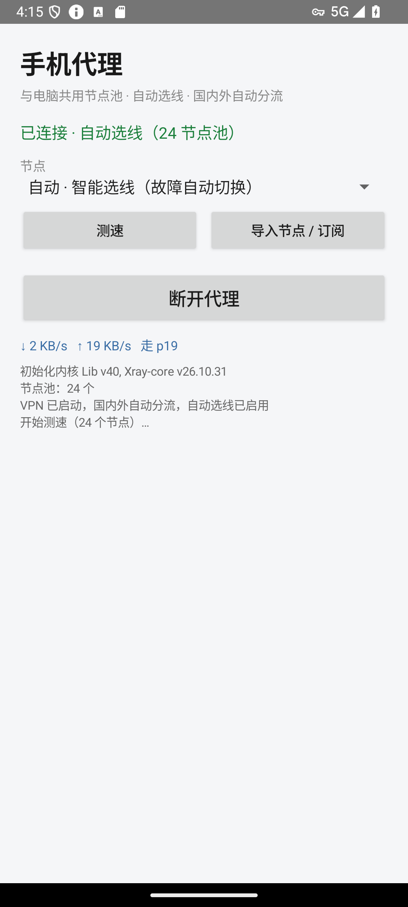

# pc-phone-proxy

[中文说明](README.md) · **English**

<p>


</p>

An auto-selecting proxy for **Windows (portable + installed, sing-box)** and **Android (own app, Xray)**.
It harvests public nodes, benchmarks them itself (TCP → download → upload → a region gate), picks the
fastest working egress, switches when a node dies, and keeps domestic traffic direct.
No account, no telemetry, no paid tier. Current release line: **v4.0.0**.

> **This repository ships no usable nodes.** Node credentials are someone else's password. The public APK
> contains no nodes but does contain **one-tap import from public lists** (URLs only, fetched at runtime).
> The Windows side builds its own pool from public sources automatically.

> **Two APKs, don't mix them up.** `PhoneProxy-public.apk` is the credential-free build: tap
> *Import → From public sources* and it fetches a pool, then benchmarks it. Want zero taps after install?
> Build the private variant yourself (`assets/nodes.json` is git-ignored and must never be committed).
> Both are signed with the same key, so they install over each other.

**v4.0.0 (2026-11-28)** adds a least-privilege Windows TUN broker, install hash/ACL verification,
DPAPI-protected loopback control credentials, transactional config replacement, a tray shell and signed
update staging. Android adds Keystore-encrypted credentials, DNS-pinned HTTPS subscriptions, signed source
manifests, subscription CRUD, node search/filter/favorites, per-app routing and cancellation-safe lifecycle.
Release tooling emits CycloneDX 1.6 SBOMs, SLSA v1 provenance and signed monotonic update manifests.
Offline builds and CI checks pass; real-device VPN/Keystore/network tests and real Windows TUN/UAC/upgrade
acceptance remain required. The local Windows installer is unsigned and the APK uses the existing test key;
production publishing still requires production signing and legal/compliance review.



## What it does

**Android (7.0+, v4.0)**

- One-tap start: benchmarks the whole pool concurrently, then Xray's observatory re-checks it every 10
  minutes with a 16 KB probe and fails over automatically
- Split tunnelling: `geosite:cn` / `geoip:cn` / private ranges direct, everything else through the proxy
- **AI egress gate (v2.5)**: one tap probes `chatgpt.com` and `claude.ai` through the fastest nodes on the
  device; only nodes that answer 200/204 to *both* join `cg-balancer`, which is the only path for
  ChatGPT/Claude domains. Results are keyed by node fingerprint and kept 1 day (the list shows `AI✓`).
  Without it, publicly imported nodes have no region qualification at all and AI traffic lands on a random
  egress — the classic "internet works but ChatGPT returns 403"
- **Kernel pre-check / quarantine (v2.6)**: imports and every start validate configs with the real Xray
  kernel in a zero-network dry run; nodes the kernel rejects are skipped instead of taking the tunnel down
- Import: `vless://` `vmess://` `trojan://` `ss://` `hysteria2://` share links, HTTPS-only subscriptions,
  or the signed public-source importer (raw + mirrors, runtime fetch, on-device validation)
- Subscription manager (add/update/enable/disable/delete), node search, protocol filters and favorites;
  URLs and credentials are stored as Android Keystore AES-256-GCM envelopes
- TUN mode, no root; four ABIs (arm64-v8a, armeabi-v7a, x86, x86_64)
- Manual node selection or auto; live up/down rate; clear guidance when the pool is empty

**Windows (10/11 x64, portable)**

- One command to build a pool: harvest public sources → TCP pre-filter → deep test (download/upload/ChatGPT
  region gate) → pick the fastest egress
- Three channels: `general 2101/2100` (ChatGPT/Claude), `fast 2103/2102` (Google/GitHub/HF/web),
  `cli 2090` (git/pip/curl/npm); optional Reddit `2086/2085` and Steam `2096/2097`
- TUN mode builds the Google-AI and Amazon groups inside the main sing-box instance; `2098/2099` is
  split-mode only, `19090`/`19091` are the two Clash APIs, `8891` serves PAC
- PAC-based browser split tunnelling; shell proxy variables set for you
- Watchdog: repairs dead ports, broken PAC, unreachable sites — and degrades instead of tearing down the
  only surviving stack. Large transfers are protected, but a >60 s flow below 30 KB/s is released when a
  3x-faster deep-tested exit exists, so a stalled "zombie" stream cannot block rebuilds forever
- Periodic re-scan every 12 hours (`PROXY_REFRESH_HOURS`), so faster nodes replace slower ones
- Every listener binds `127.0.0.1`; one command removes PAC and env vars

## Quick start

**Android** — install `PhoneProxy-public.apk` from [Releases](../../releases), open it, allow notifications,
then *Import → From public sources* → *Start*. Or paste your own subscription.

**Windows**

```
pc/
├─ _proxy/
│  ├─ bin/sing-box.exe      ← download the official release yourself
│  ├─ harvest.py            ← harvest public sources
│  ├─ deep_test.py          ← deep test (download/upload/ChatGPT gate)
│  ├─ bestroute.py          ← pick egress, write pinned.json + PAC
│  ├─ start_proxy.py        ← start egress groups, install PAC, re-verify
│  ├─ stop_proxy.py         ← remove proxy, back to direct
│  ├─ watchdog.py           ← background self-healing
│  ├─ pacroute.py           ← local PAC server + split lists
│  ├─ doctor.py             ← one-shot health check (ports → PAC → sites → egress IP → watchdog)
│  ├─ privacy_check.py      ← read-only privacy audit
│  └─ proxy_diag.py         ← why is this domain direct/proxied, and which path works
├─ start-proxy.bat
├─ check-proxy.bat          ← health check entry point
└─ stop-proxy.bat
```

```bat
pip install -r pc\_proxy\requirements.txt
cd pc\_proxy
python harvest.py
python deep_test.py
python bestroute.py --apply
python start_proxy.py
```

## Privacy design

On by default: sensitive domains (banking, payment, government, social security, tax, education — 29 entries,
shared by PC and Android) bypass the tunnel; plain HTTP(80) and DNS(53) go direct; proxied UDP is rejected;
private ranges never enter the tunnel. `privacy_check.py` audits the exit IP, plaintext leaks, list coverage
and system root certificates (MITM).

What no proxy client can protect you from: the node operator sees your real IP, the domains you visit
(TLS SNI / CONNECT host), timing and volume. **Don't log into banking, payment or work systems through a
free node** — this project routes those domains direct for that reason.

## How it works

```
public sources ──harvest──> candidates.jsonl
                                │
                    deep_test (TCP / download / upload / ChatGPT gate)
                                │
                         node_deep.json
                                │
        ┌───────────────────────┴───────────────────────┐
        │ bestroute.py --apply                          │ gen_pool.py
        ▼                                               ▼
  sing-box egress + PAC                        assets/nodes.json
  general 2101 / fast 2103                     (private APK only)
  cli 2090 / reddit 2086
```

The Android app doesn't reimplement protocols: it embeds **Xray-core** via AndroidLibXrayLite, and share
links and bundled nodes go through the same parser.

## Build

- **APK**: see [`phone/README.md`](phone/README.md) — no Gradle; `build_apk.py` runs
  `javac → d8 → aapt2 → zip → zipalign → apksigner`. Needs JDK 17, Android SDK build-tools and
  `libv2ray.aar` from [AndroidLibXrayLite](https://github.com/2dust/AndroidLibXrayLite/releases).
- **Windows**: portable mode remains plain Python. The installed product is built from `pc/app`, `pc/_proxy`
  and `pc/installer/PhoneProxy.iss`; stage `pc/runtime/python`, `pc/runtime/tray.exe` and `pc/_proxy/bin`,
  compile with Inno Setup 7.1.1, then run `python pc/check_release.py pc/dist/PhoneProxy-Setup-4.0.0.exe`.
  The local installer is unsigned; production releases must be code-signed.

## Split-routing self-healing (2026-11-18)

Four defects, each harmless on its own, combined into "all egresses are up but Claude will not
open in a browser": `autoroute.py --apply` called `apply_pac()` without arguments and fell back to
static default ports (`9910` Geph not running, `2086` not an inbound in the pinned config); `apply_pac()`
never checked whether those ports were listening and still wrote a **fail-closed** `GENERAL` rule;
the watchdog's PAC self-heal only compared the registry URL and server liveness, so it never noticed
the content was wrong; and `autoroute`'s probes sent only a User-Agent, so `claude.ai` answered 403 to
the probe (302 with `Accept` / `Accept-Language` / `sec-ch-ua`), which dropped the whole anthropic group
from `route_map.json`.

Now: `apply_pac()` resolves `general/fast` to ports that actually listen and **refuses to write** when
none do; the watchdog parses the served PAC and re-applies if any `GENERAL` port is dead; `autoroute`
skips exits whose upstream is dead and keeps the previous routing for a group it cannot measure;
both probes send browser headers; `autoroute` holds a single-instance lock; the PAC fallback chain is
de-duplicated. `doctor.py` / `check-proxy.bat` gives a layered verdict (ports → PAC → system proxy →
7 sites → egress identity → watchdog), and `tests_ci/test_route_selfheal.py` pins all of it in CI.

## Known limits

- Free public nodes are unstable; this project automates *selection and failover*, it can't guarantee speed
- ChatGPT's region gate eliminates some nodes; elimination doesn't mean the node is broken
- Android 7.0+ only; iOS and HarmonyOS NEXT are not supported
- The Windows side is only tested on Windows 10/11 x64
- v4.0.0 offline builds and automated checks do not replace real Windows TUN/UAC/upgrade acceptance or
  physical-device VPN/Keystore/network/DNS/IPv6/WebRTC/battery/accessibility testing
- The desktop APK uses the existing test keystore and the local Windows installer is unsigned. Production
  publishing requires production signing and legal/compliance review; hardening is not authorization to
  provide cross-border network services in mainland China

## License

MIT — see [`LICENSE`](LICENSE). Third-party components (Xray-core, AndroidLibXrayLite, sing-box,
geoip/geosite data) keep their own licences — see [`THIRD_PARTY_NOTICES.md`](THIRD_PARTY_NOTICES.md).

For personal study and accessing publicly available resources; follow the laws of your jurisdiction.

## Feedback

Open an [issue](../../issues) with your OS and version, the step that failed, and the output of
`proxy_diag.py` or `privacy_check.py`. **Never paste node links, subscription URLs or screenshots
containing credentials.**

---

## More from the same author

- [LuHui Player](https://github.com/gedouluhui/luhui-player) — a Windows video player built on mpv with a hand-drawn Fluent UI
- [LuHui Music Player](https://github.com/gedouluhui/luhui-music-player) — WinUI 3 shell + WASAPI exclusive-mode music player
- [Fanqie Alarm](https://github.com/gedouluhui/fanqie-alarm) — a Pomodoro timer that is one HTML file
