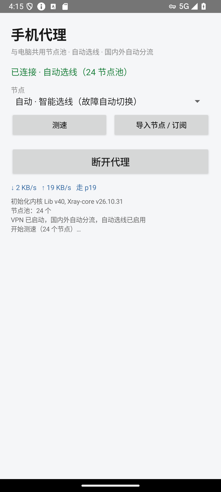

# pc-phone-proxy

[中文说明](README.md) · **English**

<p>


</p>

An auto-selecting proxy for **Windows (portable, sing-box)** and **Android (own app, Xray)**.
It harvests public nodes, benchmarks them itself (TCP → download → upload → a region gate), picks the
fastest working egress, switches when a node dies, and keeps domestic traffic direct.
No account, no telemetry, no paid tier.

> **This repository ships no usable nodes.** Node credentials are someone else's password. The public APK
> contains no nodes but does contain **one-tap import from public lists** (URLs only, fetched at runtime).
> The Windows side builds its own pool from public sources automatically.

> **Two APKs, don't mix them up.** `PhoneProxy-public.apk` is the credential-free build: tap
> *Import → From public sources* and it fetches a pool, then benchmarks it. Want zero taps after install?
> Build the private variant yourself (`assets/nodes.json` is git-ignored and must never be committed).
> Both are signed with the same key, so they install over each other.



## What it does

**Android (7.0+, v2.4)**

- One-tap start: benchmarks the whole pool concurrently, then Xray's observatory re-checks it every 30 s
  and fails over automatically
- Split tunnelling: `geosite:cn` / `geoip:cn` / private ranges direct, everything else through the proxy
- Import: `vless://` `vmess://` `trojan://` `ss://` share links, `http(s)` subscriptions, or the built-in
  public-source importer (7 lists, GitHub raw + jsDelivr mirror, 40 per source, 120 total)
- TUN mode, no root; four ABIs (arm64-v8a, armeabi-v7a, x86, x86_64)
- Manual node selection or auto; live up/down rate; clear guidance when the pool is empty

**Windows (10/11 x64, portable)**

- One command to build a pool: harvest public sources → TCP pre-filter → deep test (download/upload/ChatGPT
  region gate) → pick the fastest egress
- Three channels: `general 2101` (ChatGPT/Claude), `fast 2103` (Google/GitHub/HF/web), `cli 2090`
  (git/pip/curl/npm); optional Reddit 2086 and Steam 2096
- PAC-based browser split tunnelling; shell proxy variables set for you
- Watchdog: repairs dead ports, broken PAC, unreachable sites — and degrades instead of tearing down the
  only surviving stack
- Periodic re-scan every 6 hours (`PROXY_REFRESH_HOURS`), so faster nodes replace slower ones
- Every listener binds `127.0.0.1`; one command removes PAC and env vars

## Quick start

**Android** — install `PhoneProxy-public.apk` from [Releases](../../releases), open it, allow notifications,
then *Import → From public sources* → *Start*. Or paste your own subscription.

**Windows**

```
pc/
├─ _proxy/
│  ├─ bin/sing-box.exe      ← download the official release yourself
│  ├─ harvest.py            ← harvest public sources
│  ├─ deep_test.py          ← deep test (download/upload/ChatGPT gate)
│  ├─ bestroute.py          ← pick egress, write pinned.json + PAC
│  ├─ start_proxy.py        ← start egress groups, install PAC, re-verify
│  ├─ stop_proxy.py         ← remove proxy, back to direct
│  ├─ watchdog.py           ← background self-healing
│  ├─ pacroute.py           ← local PAC server + split lists
│  ├─ privacy_check.py      ← read-only privacy audit
│  └─ proxy_diag.py         ← why is this domain direct/proxied, and which path works
├─ start-proxy.bat
└─ stop-proxy.bat
```

```bat
pip install -r pc\_proxy\requirements.txt
cd pc\_proxy
python harvest.py
python deep_test.py
python bestroute.py --apply
python start_proxy.py
```

## Privacy design

On by default: sensitive domains (banking, payment, government, social security, tax, education — 29 entries,
shared by PC and Android) bypass the tunnel; plain HTTP(80) and DNS(53) go direct; proxied UDP is rejected;
private ranges never enter the tunnel. `privacy_check.py` audits the exit IP, plaintext leaks, list coverage
and system root certificates (MITM).

What no proxy client can protect you from: the node operator sees your real IP, the domains you visit
(TLS SNI / CONNECT host), timing and volume. **Don't log into banking, payment or work systems through a
free node** — this project routes those domains direct for that reason.

## How it works

```
public sources ──harvest──> candidates.jsonl
                                │
                    deep_test (TCP / download / upload / ChatGPT gate)
                                │
                         node_deep.json
                                │
        ┌───────────────────────┴───────────────────────┐
        │ bestroute.py --apply                          │ gen_pool.py
        ▼                                               ▼
  sing-box egress + PAC                        assets/nodes.json
  general 2101 / fast 2103                     (private APK only)
  cli 2090 / reddit 2086
```

The Android app doesn't reimplement protocols: it embeds **Xray-core** via AndroidLibXrayLite, and share
links and bundled nodes go through the same parser.

## Build

- **APK**: see [`phone/README.md`](phone/README.md) — no Gradle; `build_apk.py` runs
  `javac → d8 → aapt2 → zip → zipalign → apksigner`. Needs JDK 17, Android SDK build-tools and
  `libv2ray.aar` from [AndroidLibXrayLite](https://github.com/2dust/AndroidLibXrayLite/releases).
- **Windows**: plain Python, no build step — drop `sing-box.exe` into `pc/_proxy/bin/`.

## Known limits

- Free public nodes are unstable; this project automates *selection and failover*, it can't guarantee speed
- ChatGPT's region gate eliminates some nodes; elimination doesn't mean the node is broken
- Android 7.0+ only; iOS and HarmonyOS NEXT are not supported
- The Windows side is only tested on Windows 10/11 x64

## License

MIT — see [`LICENSE`](LICENSE). Third-party components (Xray-core, AndroidLibXrayLite, sing-box,
geoip/geosite data) keep their own licences — see [`THIRD_PARTY_NOTICES.md`](THIRD_PARTY_NOTICES.md).

For personal study and accessing publicly available resources; follow the laws of your jurisdiction.

## Feedback

Open an [issue](../../issues) with your OS and version, the step that failed, and the output of
`proxy_diag.py` or `privacy_check.py`. **Never paste node links, subscription URLs or screenshots
containing credentials.**
