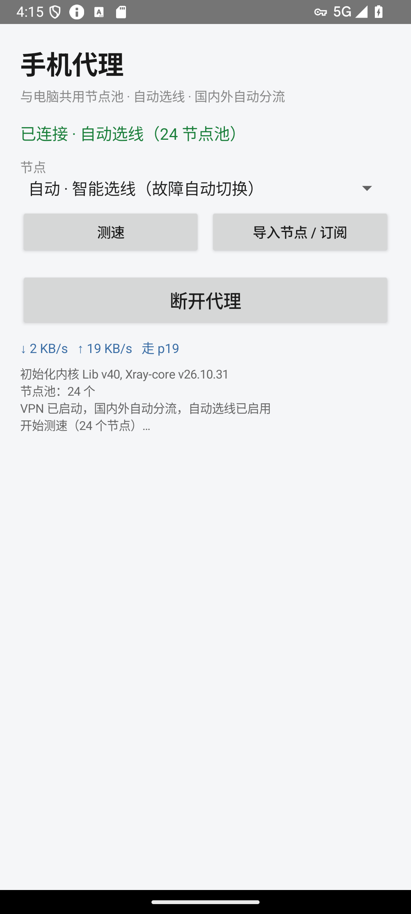

# 手机 + 电脑 双端自动选线代理

一套自己写的轻量代理工具：**Windows 便携版** 负责在电脑上自动挑最快、能过地区封锁的出口；**Android APP** 把同一批节点装进手机，一键启动、自动测速、故障自动切换。两端都做国内外分流，国内网站直连。

> 本仓库**不附带任何可用节点**。节点是第三方免费资源，分享节点凭据等于分享密码。公共版 APK 的节点列表为空，请安装后导入你自己的分享链接或订阅地址。电脑端脚本用于从公开源抓取、实测并挑选节点，建立你自己的节点池。



## 功能

**手机端（自研 Java + Xray 内核）**

- 一键启动：对节点池里的全部节点并发测速，自动选最快；运行中由 Xray observatory 每 30 秒巡检，节点掉线自动切换
- 国内外自动分流：`geosite:cn` / `geoip:cn` / 私有地址走直连，其余走代理
- 支持导入 `vless://` `vmess://` `trojan://` `ss://` 分享链接（每行一条），也支持 `http(s)` 订阅地址
- 无需 root；TUN 模式；内置 arm64-v8a / armeabi-v7a / x86 / x86_64 四个 ABI
- 手动指定节点 / 自动模式；实时上下行速率；节点池为空时有明确引导
- 不读短信、不读通讯录、无账号、无遥测

**电脑端（Windows 10/11 x64）**

- 一条命令启动：抓取公开节点源 → TCP 初筛 → 下载/上传/ChatGPT 地区闸门深测 → 选出当前最快出口
- 两个出口组 + 一条命令行通道：`general 2101`（ChatGPT/Claude）、`fast 2103`（Google/GitHub/HF/网页）、`cli 2090`（git/pip/curl/npm）
- 浏览器走 PAC 自动分流；国内站点直连；命令行代理变量自动配置
- 看门狗自愈：端口掉线、站点打不开、PAC 被改都会自动修复；检测失败时**降级而不是拆掉唯一存活的栈**
- `stop_proxy.py` 一键撤掉 PAC/环境变量，恢复直连
- 另含 Reddit 专用 2086、Steam 专用 2096 等可选出口

## 手机端快速开始

1. 到 [Releases](../../releases) 下载 `PhoneProxy-public.apk`（本地构建产物名为 `手机代理-公版.apk`；也可按 `phone/README.md` 自行构建）。
2. Android 7.0 及以上；首次安装需允许“安装未知来源应用”。iPhone 和 HarmonyOS NEXT 无法安装 APK。
3. 打开 App → 允许通知 → 点 **导入节点 / 订阅**，粘贴分享链接（每行一条）或订阅 URL。
4. 点 **启动代理** → 允许建立 VPN 连接 → 等待自动测速。
5. 状态变成“已连接”，用浏览器打开 `google.com` 验证。

> 节点池为空时 App 不会启动 VPN，会直接提示去导入。公共版不内置任何节点，避免把别人的节点凭据公开。

## 电脑端快速开始

目录布局（`pc/` 即便携包里的 `_proxy`）：

```
pc/
├─ _proxy/
│  ├─ bin/sing-box.exe      ← 自行下载官方 release 放这里
│  ├─ harvest.py            ← 抓公开节点源
│  ├─ deep_test.py          ← 深测下载/上传/ChatGPT 闸门
│  ├─ bestroute.py          ← 选出出口，写 pinned.json + PAC
│  ├─ start_proxy.py        ← 启动出口组、装 PAC、复验
│  ├─ stop_proxy.py         ← 撤掉代理，恢复直连
│  ├─ watchdog.py           ← 后台自愈
│  └─ pacroute.py           ← 本地 PAC 服务
├─ start-proxy.bat
└─ stop-proxy.bat
```

准备：

1. 安装 Python 3.10+，`pip install requests websocket-client`。
2. 从 [SagerNet/sing-box releases](https://github.com/SagerNet/sing-box/releases) 下载 Windows amd64 的 `sing-box.exe`，放到 `pc/_proxy/bin/`。
3. 如果所在网络访问 GitHub raw 需要前置代理，设置 `BOOT_PROXY=http://127.0.0.1:端口`；能直连就不用设。

首次建立节点池：

```bat
cd pc\_proxy
python harvest.py
python deep_test.py
python bestroute.py --apply
python start_proxy.py
```

日常使用：双击 `pc/start-proxy.bat`；关闭：双击 `pc/stop-proxy.bat`。

> 免费节点寿命有限。看门狗会在整池失效时自动重扫（12 小时最多一次），也可以手动重跑 `harvest.py` → `deep_test.py` → `bestroute.py --apply`。

## 工作原理

```
公开节点源 ──harvest──> candidates.jsonl
                          │
                    deep_test（TCP/下载/上传/ChatGPT 地区闸门）
                          │
                     node_deep.json
                          │
        ┌─────────────────┴──────────────────┐
        │ bestroute.py --apply               │ gen_pool.py
        ▼                                    ▼
  sing-box 出口组 + PAC              assets/nodes.json
  general 2101 / fast 2103           （手机端内置池）
  cli 2090 / reddit 2086                     │
        │                                    ▼
  浏览器/命令行自动分流               Android TUN + Xray
```

手机端不实现自己的协议栈：它使用开源 **Xray-core**（通过 AndroidLibXrayLite），导入链接和内置节点走同一个解析器，避免两套实现漂移。

## 构建手机 APK

见 [`phone/README.md`](phone/README.md)。不需要 Gradle：`javac → d8 → aapt2 → zip → zipalign → apksigner`，全部由 `phone/build_apk.py` 完成。需要 JDK 17、Android SDK build-tools、以及从 [2dust/AndroidLibXrayLite](https://github.com/2dust/AndroidLibXrayLite/releases) 下载的 `libv2ray.aar`。

## 安全与隐私

- 手机 APP 无账号、无统计、无遥测；不申请短信/通讯录/位置权限。
- 电脑端所有监听端口只绑定 `127.0.0.1`，局域网内其他机器连不上。
- 电脑端唯一修改的系统设置是当前用户的 WinINET `AutoConfigURL`（指向本地 PAC）；`stop_proxy.py` 会撤掉。
- 免费节点由第三方运营，运营者理论上能看到你访问的目标域名。**不要用这些节点登录银行等敏感账户。**
- 本仓库不包含任何可用的节点 URI、UUID、密码、二维码或签名私钥（示例文件里只有 `YOUR-UUID` 之类的占位符）。`pinned.json`、`nodes.json`、`node_deep.json`、`*.keystore` 已列入 `.gitignore`——如果你要公开自己的 fork，请先确认这些文件没有被提交。

## 已知限制

- 免费公开节点不稳定，速度与存活率随时间变化；本项目做的是“自动挑选 + 自动切换”，不能保证任何时候都有高速节点。
- ChatGPT 有地区封锁，深测会淘汰一部分节点；被淘汰不代表节点本身不可用。
- 手机端只支持 Android 7.0+；iOS 与 HarmonyOS NEXT 无法安装。
- 电脑端只在 Windows 10/11 x64 上实测过。
- 仅供学习、网络研究与个人使用；请遵守当地法律法规及目标服务的条款。

## 许可

本项目自己的代码使用 MIT 许可证，见 [`LICENSE`](LICENSE)。内置/依赖的第三方组件（Xray-core、AndroidLibXrayLite、sing-box、geoip/geosite 数据）各自遵循其原许可证，详见 [`THIRD_PARTY_NOTICES.md`](THIRD_PARTY_NOTICES.md)。
